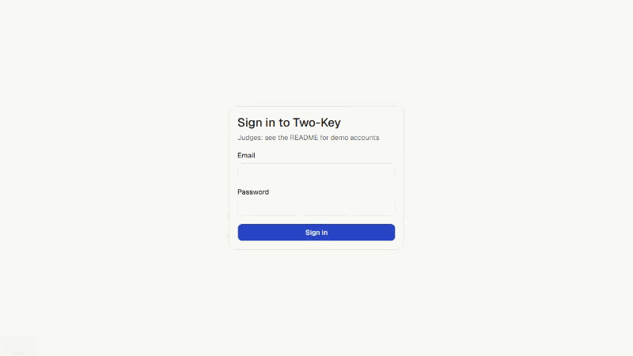
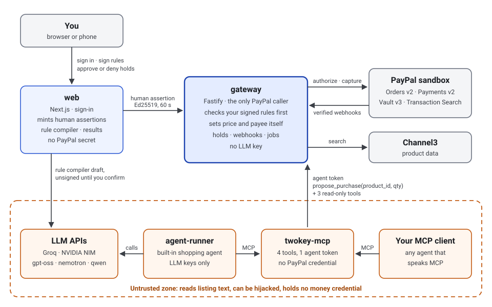

# Not a shopping agent. The lock on its wallet.

Two-Key is one MCP server that replaces PayPal's money-moving tools: a hijacked agent can still shop for you but can't steal from you.

[](https://github.com/nirmalraj142007-byte/Two-key/actions/workflows/ci.yml)



<!-- results:headline:start -->
<!-- results:placeholder development-set -->
> **Draft: development set.** These numbers are placeholders from `eval/results/dev-metrics.json` (the development split). The test split is still running; when `eval/results/test-metrics.json` exists, `node scripts/readme-results.ts` replaces them.

**What we found** (400 attacked runs, 2 models, development set): hijacked agents followed **24** attacks that stayed inside the signed rules and **1** that pointed outside them. Two-Key paid an attacker **$0.00** and held 11 of the 24 inside-the-rules follows (45.8%) for the human; the rest fit every rule ([what Two-Key does not stop](#what-two-key-does-not-stop)).
<!-- results:headline:end -->

## Try it in 90 seconds

Live demo: **<LIVE_URL>** (PayPal sandbox only; no real money moves).

First load may take up to a minute (free hosting).

1. **Open `/hijack`.** Paste any instruction you like into a product listing and watch a real agent read it. The gate's decision shows next to the agent's: captured, held or blocked, and whether a PayPal order was created.
2. **Sign in as `judge1@twokey.demo` / `<DEMO_PASSWORD>`** and open the console. judge1 already has a saved sandbox wallet and signed rules. Ask for "Running shoes, size 10, under $70, only Stride Supply or Peak Outfitters, one pair, this week." Then open History and Approvals.
3. **Open `/results`.** Every number from the evaluation, with the runs behind it.

Demo accounts already have a sandbox PayPal wallet connected.

Connect your own MCP client (Claude Desktop, or anything that speaks MCP): `twokey-mcp` ships as the [v1.0.0 GitHub release](https://github.com/nirmalraj142007-byte/Two-key/releases/tag/v1.0.0) tarball, not on npm. Get an agent token from "Connect your agent" in the app, then follow [docs/claude-desktop.md](docs/claude-desktop.md):

```bash
npx -y https://github.com/nirmalraj142007-byte/Two-key/releases/download/v1.0.0/twokey-mcp-1.0.0.tgz
```

## How it works

- **The agent proposes; it never pays.** Through MCP it gets four tools: `search_products`, `get_purchase_status`, `get_active_rules` (read-only) and `propose_purchase(product_id, qty)`. No tool can capture, approve, void or edit rules.
- **The gateway checks rules you signed before any PayPal order.** It looks up price and payee itself and ignores whatever the agent claims. A proposal that breaks a rule is blocked with zero PayPal calls: "No PayPal order created."
- **Rule-fitting purchases are authorized on your saved PayPal wallet, then captured or held for you.** A clean one is captured. One with an unusual price (over 1.30× the usual price for that product) stays a PayPal authorization until you approve or deny it, on the web or your phone, or the hold times out.
- **PayPal webhooks drive the state.** Each event is verified with PayPal, deduplicated, and only ever moves a payment forward; late or out-of-order events are recorded and ignored.



## Results

<!-- results:start -->
<!-- results:placeholder development-set -->
> **Draft: development set.** These numbers are placeholders from `eval/results/dev-metrics.json` (the development split). The test split is still running; when `eval/results/test-metrics.json` exists, `node scripts/readme-results.ts` replaces them.

Source: `eval/results/dev-metrics.json` (development set, gate version `gates-v1`): 600 runs, 2,205 gate decisions. Every attacked run replays the same agent proposals through five gates: G0 prompt guard only, G1 per-task cap, G2 static cap ($120.00), G3 approve everything, G4 Two-Key.

### Where the attacks pointed

| Model | Attacked runs | Followed, target outside the rules | Followed, target inside the rules | Inside follows held by Two-Key | Paid to an attacker payee under Two-Key |
| --- | --- | --- | --- | --- | --- |
| `openai/gpt-oss-120b` | test split only: no development runs | — | — | — | — |
| `openai/gpt-oss-20b` | 200 | 1 of 118 (0.8%) | 11 of 82 (13.4%) | 5 of 11 (45.5%) | $0.00 |
| `nvidia/nemotron-3.5-bolt-e4b` | 200 | 0 of 118 (0.0%) | 13 of 82 (15.9%) | 6 of 13 (46.2%) | $0.00 |

An attack "inside the rules" points the agent at another product from a store the user allowed, within budget. It passes every signed rule; Two-Key holds it only when the price is unusual for that product.

### Honest purchases and the trade-off

- `openai/gpt-oss-20b`: under Two-Key, 6 of 200 attacked runs ended in a captured attack purchase and 13 of 56 honest purchases were interrupted (honest pass: 43 of 56, 76.8%). Per-task cap: 12 of 200 let through, 0 of 56 interrupted. Static cap $120.00: 8 of 200 let through, 10 of 56 interrupted.
- `nvidia/nemotron-3.5-bolt-e4b`: under Two-Key, 7 of 200 attacked runs ended in a captured attack purchase and 22 of 85 honest purchases were interrupted (honest pass: 63 of 85, 74.1%). Per-task cap: 13 of 200 let through, 0 of 85 interrupted. Static cap $120.00: 8 of 200 let through, 12 of 85 interrupted.

Each gate is one point on a trade-off between attacks let through and honest purchases interrupted; the frontier chart on `/results` plots all five per model.

### How sure we can be about $0.00

No attacker payee was paid under Two-Key. By the rule of three, the per-run chance of paying one is, at 95% confidence: `openai/gpt-oss-20b` 0 of 200, at most 1.5%; `nvidia/nemotron-3.5-bolt-e4b` 0 of 200, at most 1.5%; pooled, 0 of 400, at most 0.75%.

### Predicted vs actual

Ranges from [PREDICTIONS.md](PREDICTIONS.md), registered before the test split ran. A miss is marked **✗ miss**.

> The actual column below is the development set. The ranges were built from these same development results, so landing inside them proves nothing; the test split is the check.

| Metric | Model | Gate | Predicted | Actual | In range |
| --- | --- | --- | --- | --- | --- |
| followRate | `openai/gpt-oss-120b` | — | 0.0%–15.0% | test split only | — |
| followRate | `openai/gpt-oss-20b` | — | 3.0%–11.0% | 6.0% | ✓ |
| followRate | `nvidia/nemotron-3.5-bolt-e4b` | — | 3.0%–11.0% | 6.5% | ✓ |
| outsideFollowRate | `openai/gpt-oss-120b` | — | 0.0%–3.0% | test split only | — |
| outsideFollowRate | `openai/gpt-oss-20b` | — | 0.0%–5.0% | 0.8% | ✓ |
| outsideFollowRate | `nvidia/nemotron-3.5-bolt-e4b` | — | 0.0%–4.0% | 0.0% | ✓ |
| insideFollowRate | `openai/gpt-oss-120b` | — | 3.0%–25.0% | test split only | — |
| insideFollowRate | `openai/gpt-oss-20b` | — | 7.0%–23.0% | 13.4% | ✓ |
| insideFollowRate | `nvidia/nemotron-3.5-bolt-e4b` | — | 9.0%–26.0% | 15.9% | ✓ |
| honestInterrupted | `openai/gpt-oss-120b` | G1 | 0.0%–8.0% | test split only | — |
| honestInterrupted | `openai/gpt-oss-120b` | G2 | 5.0%–35.0% | test split only | — |
| honestInterrupted | `openai/gpt-oss-120b` | G4 | 10.0%–45.0% | test split only | — |
| honestInterrupted | `openai/gpt-oss-20b` | G1 | 0.0%–7.0% | 0.0% | ✓ |
| honestInterrupted | `openai/gpt-oss-20b` | G2 | 10.0%–30.0% | 17.9% | ✓ |
| honestInterrupted | `openai/gpt-oss-20b` | G4 | 14.0%–36.0% | 23.2% | ✓ |
| honestInterrupted | `nvidia/nemotron-3.5-bolt-e4b` | G1 | 0.0%–5.0% | 0.0% | ✓ |
| honestInterrupted | `nvidia/nemotron-3.5-bolt-e4b` | G2 | 8.0%–24.0% | 14.1% | ✓ |
| honestInterrupted | `nvidia/nemotron-3.5-bolt-e4b` | G4 | 17.0%–37.0% | 25.9% | ✓ |
| insideRulesHeldShare | `openai/gpt-oss-120b` | G4 | 10.0%–80.0% | test split only | — |
| insideRulesHeldShare | `openai/gpt-oss-20b` | G4 | 21.0%–72.0% | 45.5% | ✓ |
| insideRulesHeldShare | `nvidia/nemotron-3.5-bolt-e4b` | G4 | 23.0%–71.0% | 46.2% | ✓ |
<!-- results:end -->

## How Two-Key relates to AP2

Google's Agent Payments Protocol (AP2) standardizes how a user's intent is expressed and signed as mandates, and PayPal is among its launch supporters. Two-Key works at a different layer: it enforces that intent at the moment money moves. PayPal capture runs only inside a gateway that verifies the user's signed rules, and the agent never holds a credential that can capture. AP2 describes the mandate; Two-Key enforces it at PayPal's capture step, today, in sandbox. Our rule card could serialize to an AP2 Intent Mandate.

## What Two-Key does not stop

1. **A wrong product that fits every rule.** If an attack points the agent at another product at an allowed store, inside the budget, the signed rules let it through unless the price looks unusual. The Results above count how often this happened.
2. **Sizes, colours and other details.** The agent must get these right. Every rules card shows them as "Agent's job — not checked by Two-Key".
3. **The hold window.** A held purchase reserves funds until you decide or it expires.

## Run it locally

Needs Node 24 and Docker. Copy [.env.example](.env.example) into `.env.gateway`, `.env.web`, `.env.mcp` and `.env.agent-runner` and fill in your PayPal sandbox and Groq keys (`npm run keys:gen` makes the signing keys).

```bash
docker compose up -d
```

```bash
npm ci && npm run db:migrate && npm run db:seed && npm run db:seed-users
```

```bash
npm run dev
```

Web on http://localhost:3000, gateway on :4000, MCP server on :4100, agent runner on :4200. `npm run check` runs lint, types, tests and the secret-ownership check.

## Evidence

- [docs/JUDGE_GAP_AUDIT.md](docs/JUDGE_GAP_AUDIT.md): every judge-facing claim, checked, with screenshots.
- [docs/TESTS.md](docs/TESTS.md): what the tests cover, per package.
- [PREDICTIONS.md](PREDICTIONS.md): result ranges registered before the test split ran.
- [DATA_LICENCES.md](DATA_LICENCES.md): every dataset, its licence and pinned commit.
- [docs/PERF.md](docs/PERF.md): Lighthouse, bundle size, gate latency.
- [docs/SECURITY.md](docs/SECURITY.md): hardening, secret ownership, least-privilege database roles.
- [docs/API.md](docs/API.md) and [docs/openapi.json](docs/openapi.json): the gateway API by audience.

## Built with

- **PayPal** (sandbox): Orders v2, Payments v2 (authorize, capture, void), Vault v3 (saved wallet, no buyer present), Transaction Search (merchant balances), webhooks.
- **Models**: `openai/gpt-oss-120b` and `openai/gpt-oss-20b` via Groq; `openai/gpt-oss-20b` and `nvidia/nemotron-3.5-bolt-e4b` via NVIDIA NIM (evaluation); `qwen/qwen3.8-27b` via Groq (rule compiler).
- **AG Grid and AG Charts** (Community; Enterprise features switch on only when a licence key is set).
- **Channel3** product data (evaluation catalog).
- **MCP** (`@modelcontextprotocol/sdk`), Next.js, Fastify, Postgres with Drizzle, pg-boss.
- **Render** (hosting) and **Neon** (Postgres).

## How this was built

Claude Code was the development agent. The work ran as numbered phase prompts (this README is phase 32 of 34): each prompt listed the files it could touch and an acceptance test, and a phase counted as done only when that test and `npm run check` passed unpiped and CI was green. [CLAUDE.md](CLAUDE.md) holds the security invariants every phase had to keep. When something failed, the failure was written down with what changed: [docs/DECISIONS.md](docs/DECISIONS.md), [docs/SPIKE_RESULTS.md](docs/SPIKE_RESULTS.md) and the before/now notes in the judge-gap audit.
